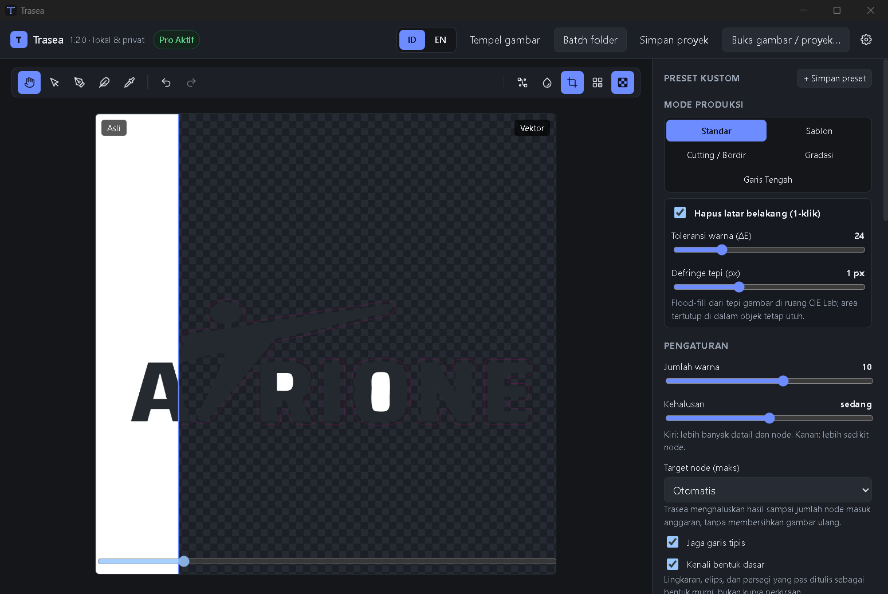
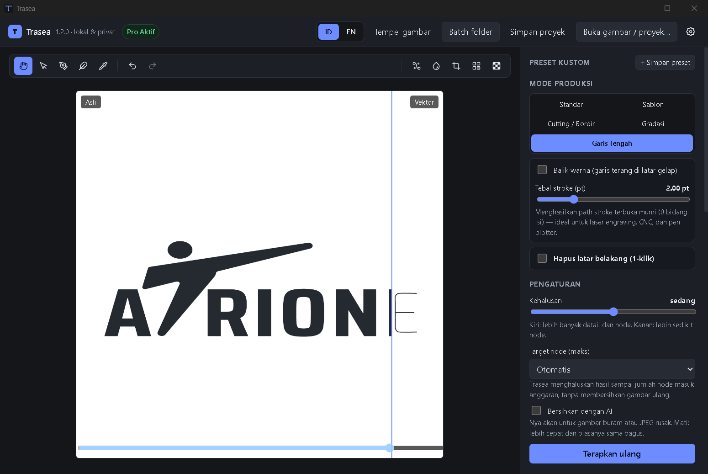
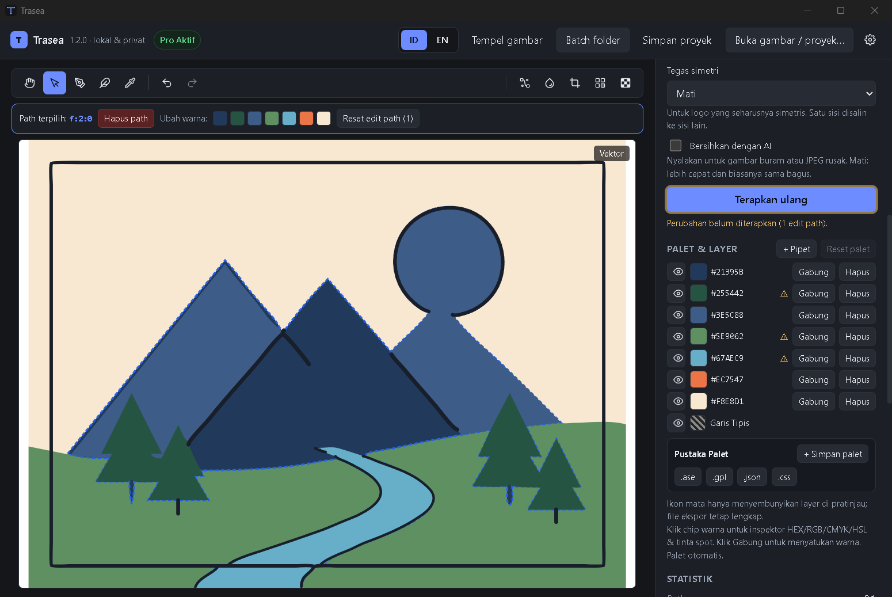
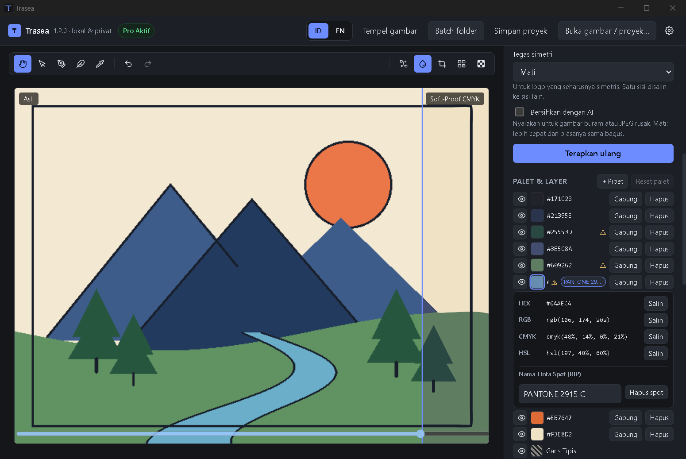
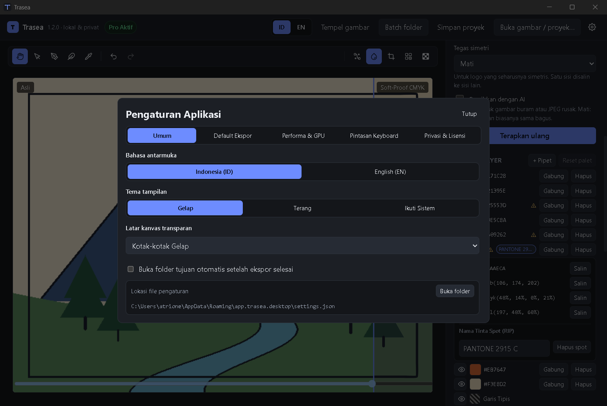
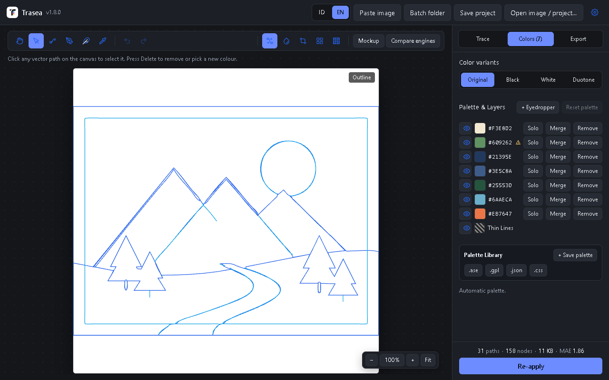
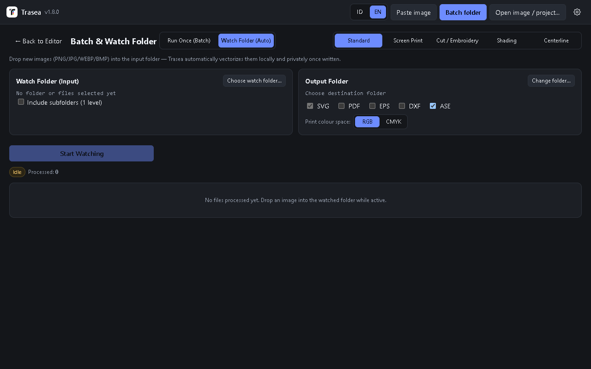

# Trasea

*English: [README.md](README.md)*

**Aplikasi desktop vektorisasi lokal & privat** (*Local-First & Private*) yang mengubah ilustrasi flat, logo, stiker, garis sketsa, dan karya *cel-shading* (PNG/JPG/WEBP/BMP) menjadi **SVG, PDF (RGB/CMYK/Spot), EPS (RGB/CMYK/Spot), dan AutoCAD R12 DXF** bersih dengan node rapi — siap untuk Affinity Designer, Adobe Illustrator, CorelDraw, RIP Roland/Mimaki/Summa, sablon, laser cutter, CNC router, dan mesin cutting/bordir. Versi **1.2.0 ("Stiker, Laser, & Presisi RIP")**. Pemrosesan lokal & privat (gambar dan vektor diproses langsung di komputer Anda tanpa unggah ke cloud dan tetap berjalan tanpa koneksi internet), dwibahasa (Indonesia & Inggris), tanpa akun.

## Tangkapan Layar



| Mode Garis Tengah / Centerline (Laser / CNC) | Pilih & Edit Path Langsung di Kanvas |
| :---: | :---: |
|  |  |

| Soft-Proof CMYK, Inspektor Kode Warna & Tinta Spot | Pengaturan Aplikasi 5 Tab & Privasi/Lisensi |
| :---: | :---: |
|  |  |

| Pratinjau Outline (Ctrl+Y) & Toggle Layer | Pantau Folder Otomatis & Log Langsung |
| :---: | :---: |
|  |  |

## Cara kerja

Empat tahap lokal ditambah pra-proses non-destruktif, lima profil produksi, edit path langsung di kanvas, Soft-Proof CMYK, tinta spot bernama, pustaka palet tersimpan, alur kerja proyek, batch folder, dan pemantau folder otomatis:

1. **Pra-proses non-destruktif.** Potong area (*crop*), putar gambar (`-90°`, `+90°`, `180°`, atau sudut bebas `-45°..+45°`), serta **Hapus Latar Otomatis 1-klik** (flood-fill 4-arah CIE Lab ΔE dari tepi + defringe halo tepi `0..3 px`) tanpa mengubah file asli.
2. **Penjaga garis tipis & Mode Garis Tengah.** Garis gelap tipis diekstrak terlebih dahulu agar tidak hilang saat pembersihan — atau aktifkan mode **Garis Tengah (`Centerline`)** untuk menghasilkan path stroke terbuka murni (0 bidang isi).
3. **Bersihkan (opsional, mati bawaan).** Real-ESRGAN (anime x4, sidecar bawaan) membuang noise JPEG dan menskalakan ke 2x. Mati: filter median 3 px bekerja 20–40x lebih cepat. Jika GPU tidak mendukung Vulkan, Trasea otomatis mundur ke Median dengan pesan yang jelas.
4. **Kunci palet / Gradasi + pelacakan + edit path + garis & kontur.** Warna rata (k-means di Lab) atau pita warna Gradasi/Cel-Shading (12–32 warna Lab dengan *bilateral smoothing*) dilacak dengan visioncortex (mesin VTracer) menjadi kurva Bézier kubik ringkas, bentuk dasar murni `<circle>`/`<ellipse>`/`<rect>`, dan tegas simetri. Hapus atau ubah warna per-path berlaku konsisten di pratinjau maupun seluruh format ekspor.

Format keluaran yang didukung:
- **SVG** dengan layer bernama (`Latar`, `Bidang warna`, `Garis`, opsional `CutContour`, opsional `Registrasi`) — plus **Salin SVG** 1 klik (`Ctrl+Shift+C`) ke clipboard
- **PDF** dalam mode **RGB**, **DeviceCMYK murni** (PDF 1.4 operator `k`/`K`, hitam & registrasi `0 0 0 1` K=100% murni), serta tinta **Named Spot `/Separation`** (termasuk `CutContour` `0,25 pt`)
- **AutoCAD R12 DXF (`AC1009`)** dengan layer terpisah (`COLOR_01_RRGGBB`, `THIN_LINES`, `CENTERLINE`, `CUTCONTOUR`, `REGISTRATION`), entitas `CIRCLE` murni, sumbu Y CAD, serta satuan `mm` (72/96/300 DPI atau lebar target khusus) / `px`
- **EPS** (*Encapsulated PostScript Level 2 / EPSF-3.0*, generator Rust murni RGB, CMYK, atau Named Spot `%%CMYKCustomColor` tanpa Ghostscript/Inkscape) — Pro
- **Ekspor palet:** **`.ase`** (Adobe Swatch Exchange RGB/CMYK dengan swatch Global & Spot `0x0001`), **`.gpl`** (GIMP/Inkscape/Krita/Blender), **`.json`**, dan variabel **`.css`**
- **Film separasi hitam 100% / K=100%** (`<nama>_film01_RRGGBB.svg`/`.pdf`) — Pro
- **`.trasea`** file proyek (JSON `schemaVersion: 1`, kompatibel penuh dengan 1.0.0 & 1.1.0) menyimpan tautan gambar sumber + SHA-256, potong/putar/hapus latar, goresan kuas, edit path, palet manual, daftar gabung warna, kontur potong, tinta spot, dan setelan ekspor

### Baru di 1.2.0 ("Stiker, Laser, & Presisi RIP")

Seluruh 8 fitur baru 1.2.0 **terbuka tanpa memerlukan kunci Pro**:

- **Garis Potong Stiker Die-Cut / Kiss-Cut (`CutContour`).** Kontur potong luar otomatis menggunakan 2D Euclidean Distance Transform + Marching Squares + penghalusan kurva Bézier (`0,5..10,0 mm`, bawaan `2,0 mm`, opsi gabung pulau berdekatan). Menulis tinta spot `CutContour` (`CMYK 0/100/0/0`, `#EC008C`, `0,25 pt`) di SVG, PDF (`/Separation`), EPS (`%%CMYKCustomColor`), DXF (polyline tertutup `CUTCONTOUR`), dan ASE (swatch Spot `0x0001`), lengkap dengan pratinjau langsung dan ikon mata layer.
- **Mode Garis Tengah (`Centerline` / Single-Line).** Mode produksi ke-5 (`--mode centerline`) memakai threshold adaptif, opsi balik warna (*invert* untuk garis terang di latar gelap), penipisan Zhang-Suen, pemangkasan taji, dan kurva Bézier terbuka murni (0 bidang isi; `LWPOLYLINE` terbuka di layer DXF `CENTERLINE`) untuk laser engraving, CNC, dan pen plotter.
- **Hapus Latar Otomatis (1-Klik) & Defringe.** Flood-fill 4-arah dari tepi gambar di ruang CIE Lab (`ΔE 0..100`, bawaan `24`) + defringe halo tepi (`0..3 px`, bawaan `1`) langsung di panel kiri maupun modal Potong & Putar; area tertutup di dalam objek tetap utuh.
- **Pilih & Edit Path Langsung di Kanvas.** Aktifkan alat **Pilih Path** (`Ctrl+E`) untuk menyorot dan mengklik path vektor di kanvas, menghapusnya (`Delete`/`Backspace`), mengubah warnanya ke warna palet lain, atau mereset edit path — non-destruktif, terhubung ke Undo/Redo, dan ikut terekspor ke SVG, PDF, EPS, & DXF.
- **Pratinjau Soft-Proof CMYK & Peringatan Luar Gamut.** Nyalakan **Soft-Proof CMYK** (`Ctrl+P`) untuk simulasi gamut cetak CMYK instan (0 ms) di kanvas, ditambah lencana `⚠` pada warna neon di palet yang berada di luar gamut CMYK.
- **Penamaan Tinta Spot (Named Spot Color) untuk RIP.** Beri nama tinta spot kustom (mis. `White_Underbase`, `PANTONE 185 C`) pada warna palet lewat Inspektor Warna; diekspor sebagai PDF `/Separation`, EPS `%%CMYKCustomColor`, dan ASE Spot (`0x0001`).
- **Modal Pengaturan Aplikasi 4 Tab (`⚙` / `Ctrl+,`).** Tersimpan di `settings.json`: **Umum** (Bahasa ID/EN, Tema Gelap / Terang / Ikuti Sistem, latar kanvas transparan, buka folder otomatis setelah ekspor), **Default Ekspor** (RGB/CMYK, satuan DXF, 72/96/300 DPI, bawaan offset/nama/bridge `CutContour`), **Performa & GPU** (Otomatis GPU vs Selalu Median Cepat, batas Undo 20/50/100), dan **Pintasan Keyboard** (perekam kombinasi tombol kustom + deteksi bentrok + reset).
- **Inspektor Kode Warna & Pustaka Palet Tersimpan.** Klik chip warna di palet untuk melihat dan menyalin 1-klik kode **HEX**, **RGB**, **CMYK**, dan **HSL**; simpan, terapkan ulang, dan hapus palet brand di `palettes.json`; ekspor palet ke **`.gpl`**, **`.json`**, dan **`.css`** selain `.ase`.

### Pencapaian versi sebelumnya

- **1.1.0 ("Alur Kerja Cepat & Produksi Penuh"):** Ekspor DXF R12 (`mm`/`px`), ekspor cetak DeviceCMYK murni (PDF/EPS/ASE), Sablon Knockout Murni, Pantau Folder otomatis, Clipboard Masuk/Keluar (`Ctrl+V` / `Ctrl+Shift+C`), pratinjau Outline (`Ctrl+Y`) & ikon mata layer, UI Dwibahasa ID/EN, Potong & Putar non-destruktif, Mode Gradasi/Cel-Shading.
- **1.0.0 ("Siap Dijual"):** Ekspor EPS murni, lisensi lokal Ed25519 & trial ramah, modal Privasi & Lisensi, file proyek `.trasea`, Undo/Redo, Preset Kustom, ilustrasi contoh 1 klik, perbaikan kontinuitas garis tipis melengkung.
- **0.5.0 ("Produksi"):** Batch folder + laporan CSV/Markdown, Mode Sablon (2–8 warna spot, tanda registrasi, film separasi `#000000`), Mode Cutting/Bordir *knockout*, pilih target warna saat Gabung palet, ikon macOS `icon.icns`.
- **0.4.0 ("Kendali desainer"):** Rebrand Vektora → Trasea, kuas koreksi (`Kuas Detail`/`Kuas Halus`), palet manual + pipet median 5×5, heatmap node, target jumlah node, cache `PreparedImage`.
- **0.3.0 ("Geometri rapi"):** Bentuk dasar murni, tegas simetri, sudut tajam vs kurva halus per titik, peringatan area teks lokal, histeresis garis tipis utuh.

## Pakai

1. Unduh dan ekstrak [`releases/Trasea_1.2.0_x64-setup.zip`](releases/Trasea_1.2.0_x64-setup.zip), jalankan `Trasea_1.2.0_x64-setup.exe` (per pengguna, tanpa admin), lalu buka Trasea.
2. Ganti bahasa (`ID | EN`) atau buka **Pengaturan Aplikasi (`⚙` / `Ctrl+,`)** kapan saja untuk memilih tema Gelap/Terang/Ikuti Sistem, default ekspor, dan pintasan keyboard kustom.
3. Klik **Coba contoh gambar**, tekan `Ctrl+V` untuk menempel dari clipboard, seret gambar/proyek `.trasea`/folder ke jendela, atau klik **Buka gambar / proyek…**.
4. Gunakan **Hapus latar belakang (1-klik)**, **Potong & Putar**, **Mode Produksi** (**Standar**, **Sablon**, **Cutting / Bordir**, **Gradasi**, **Garis Tengah**), **Pilih Path (`Ctrl+E`)**, **Soft-Proof CMYK (`Ctrl+P`)**, **Outline (`Ctrl+Y`)**, Inspektor Warna (klik chip warna untuk HEX/RGB/CMYK/HSL & tinta spot), dan Pustaka Palet Tersimpan.
5. Aktifkan **Garis Potong Stiker (`CutContour`)** bila menyiapkan stiker, salin SVG (`Ctrl+Shift+C`), ekspor **SVG**, **PDF (RGB/CMYK/Spot)**, **DXF (mm/px)**, **palet `.ase`/`.gpl`/`.json`/`.css`**, atau jalankan **Pantau Folder** secara bebas; aktifkan kunci Pro lokal di **Privasi & Lisensi** untuk membuka **EPS**, **Film Separasi**, dan **Batch Sekali Jalan**.

## Build dari sumber

Butuh Rust (`x86_64-pc-windows-gnu` + MinGW-w64 di `PATH`, atau MSVC; macOS Universal butuh `aarch64-apple-darwin` + `x86_64-apple-darwin`), Node 22+, dan WebView2 di Windows.

```
npm ci
node scripts/fetch-sidecar.mjs
npx tauri build --target x86_64-pc-windows-gnu
```

Alat pengembang:

```
npm test                                   # 81 tes cargo: V1-V7, W1-W6, G1-G8, D0-D6, T-01..T-09, E-01..E-03, L-01..L-03, P-01..P-02, N-01, F-01..F-10, G12-01..G12-10
cargo run --release --bin trasea-cli -- in.png out.svg [--remove-bg] [--bg-tolerance 24] [--defringe 1] [--mode standard|sablon|cutting|shading|centerline] [--centerline-invert] [--centerline-stroke-pt 1.0] [--die-cut] [--die-cut-mm 2.0] [--die-cut-name CutContour] [--spot "#E63946=PANTONE 185 C"] [--pdf out.pdf] [--eps out.eps] [--dxf out.dxf] [--ase out.ase] [--color-space rgb|cmyk] [--dxf-unit mm|px] [--dxf-width-mm 120] [--crop X,Y,W,H] [--rotate DEG] [--separations dir]
cargo run --release --bin trasea-cli -- --batch <folder-input> <folder-output> [--mode standard|sablon|cutting|shading|centerline] [--remove-bg] [--die-cut] [--color-space rgb|cmyk] [--pdf] [--eps] [--dxf] [--ase] [--separations] [--subfolders] [--no-report]
cargo run --release --bin trasea-cli -- --watch <folder-input> <folder-output> [--poll-ms 1000] [--debounce-ms 500] [--dxf] [--pdf] [--die-cut] [--color-space cmyk]
cargo run --release --bin trasea-keygen -- init | issue --secret <HEX> --name "..." --id "TR-2026-0001" | verify <KEY>
cargo run --release --bin bench -- --dir <folder vectorize-bench> --sidecar <folder realesrgan>
```

Baca [docs/RELEASE-SIGNING.md](docs/RELEASE-SIGNING.md) sebelum distribusi komersial.

## Pemrosesan Lokal, Privasi, & Lisensi

Seluruh pembersihan gambar, vektorisasi, dan ekspor berjalan langsung di komputer Anda tanpa mengunggah desain ke cloud, dan Trasea tetap bekerja tanpa koneksi internet. Crate inti `trasea-core` tidak menautkan crate HTTP/jaringan maupun crate GPL/AGPL apa pun (terverifikasi otomatis oleh `V7`, `N-01`, `F-09`, dan `G12-10`), serta WebView menerapkan CSP ketat ke IPC lokal. Lihat [docs/LICENSE-AUDIT-1.2.0.md](docs/LICENSE-AUDIT-1.2.0.md) dan [THIRD_PARTY_LICENSES.md](THIRD_PARTY_LICENSES.md).
