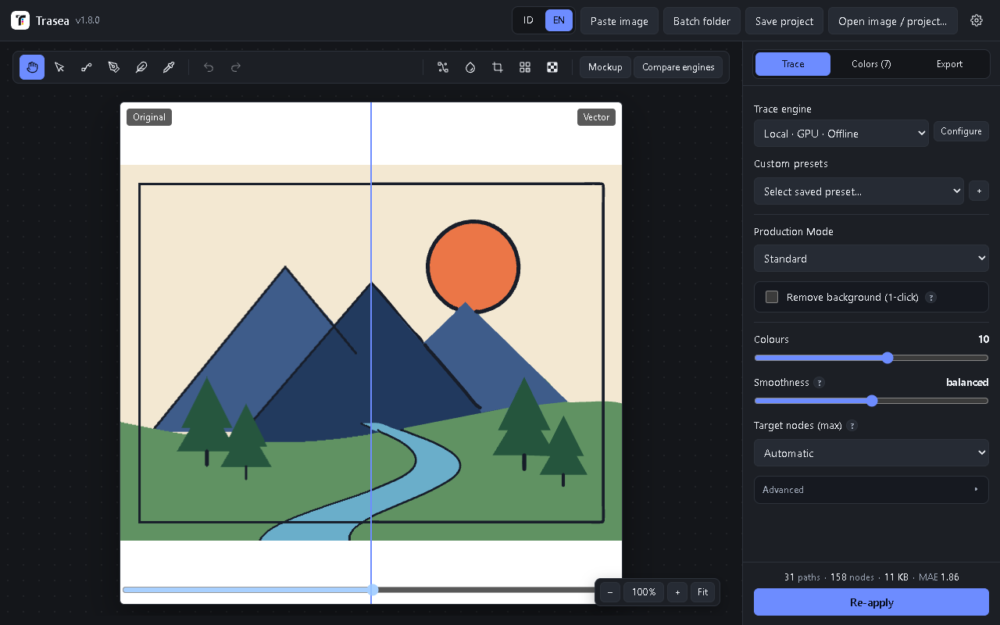
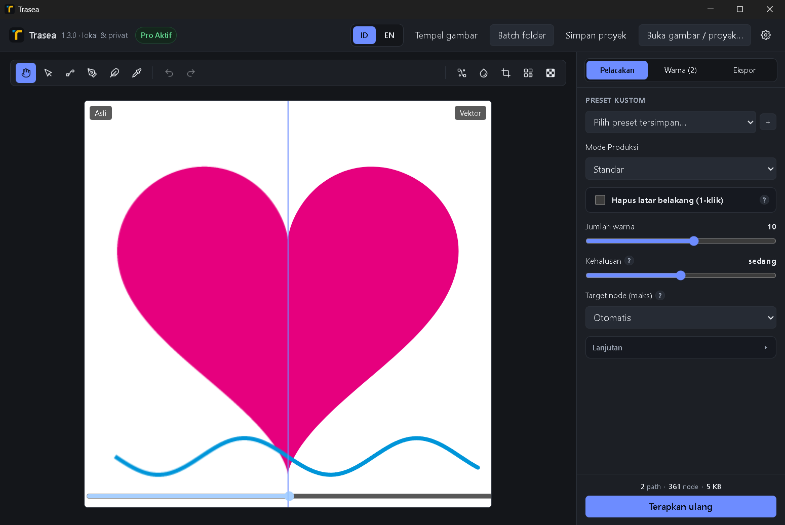
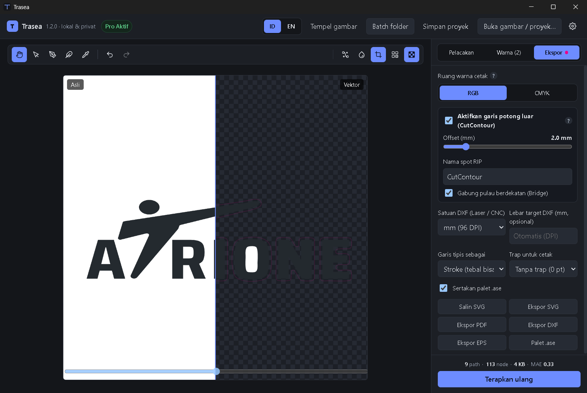
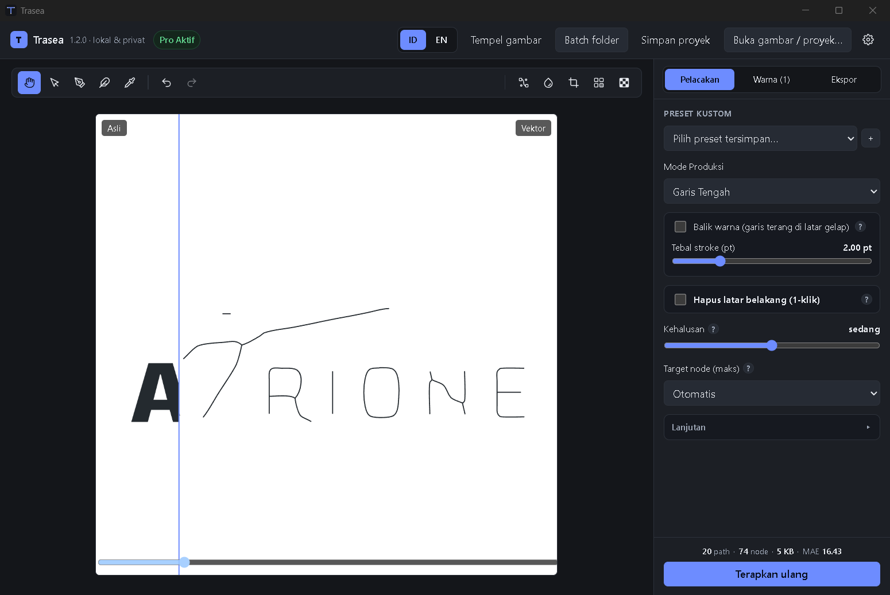
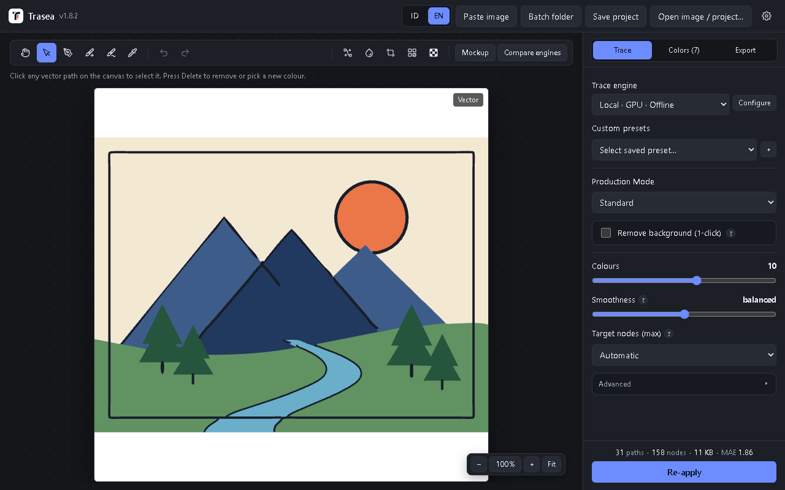
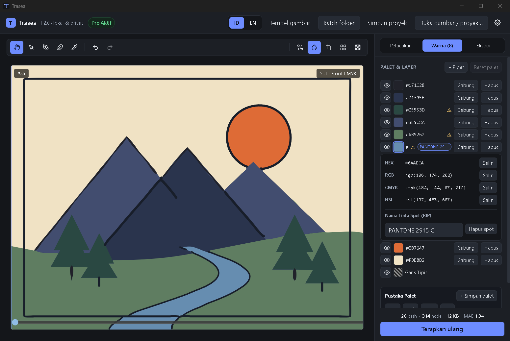
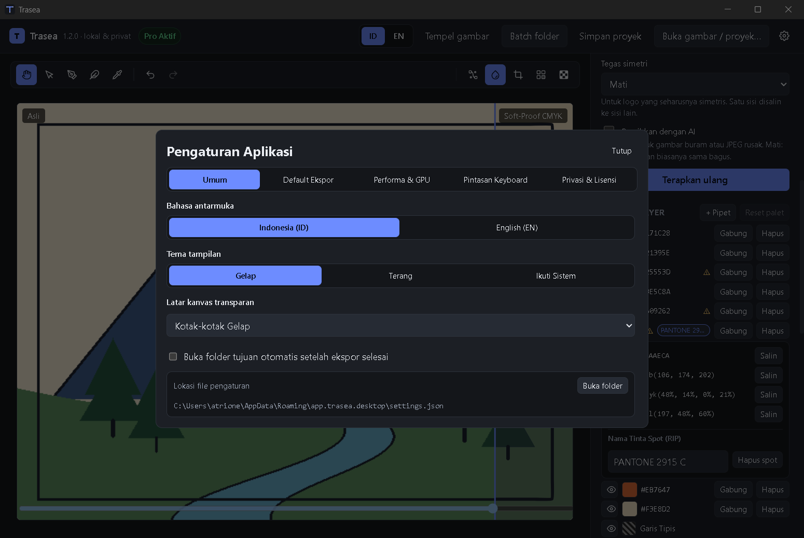
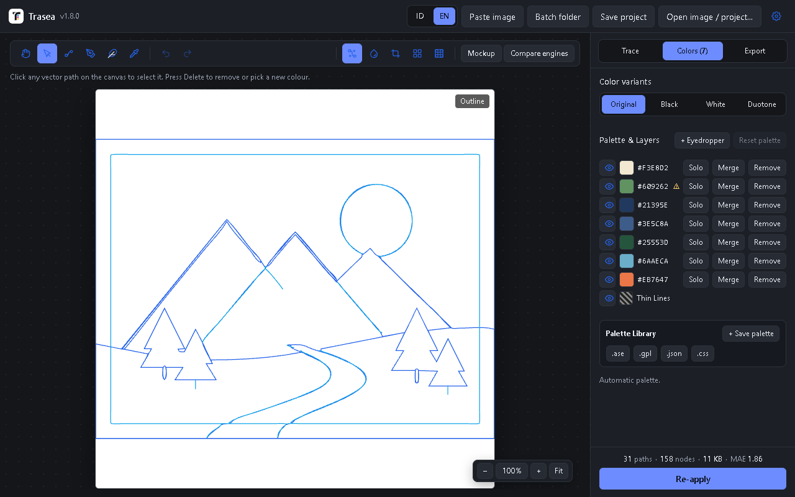
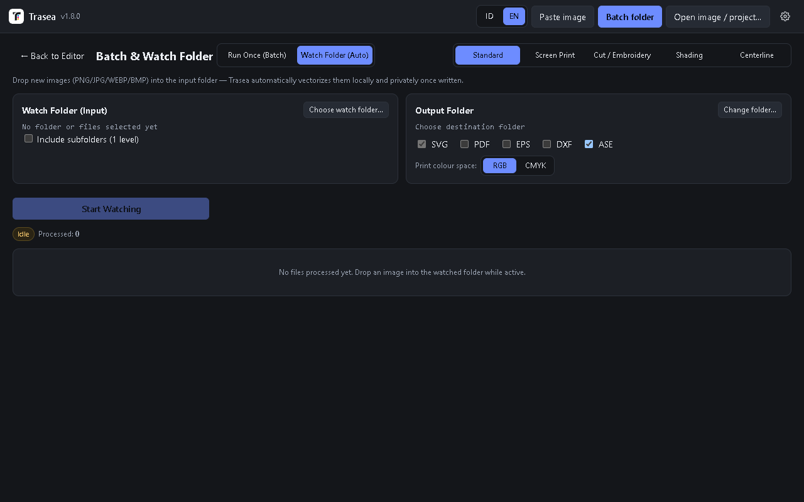

<p align="center"></p>

# Trasea

*Indonesian documentation: [README.id.md](README.id.md)*

A **local-first & private desktop vectorization app** that turns flat illustrations, logos, stickers, line sketches, and cel-shaded artwork (PNG/JPG/WEBP/BMP, or existing SVG files) into clean **SVG, PDF (RGB/CMYK/Spot), EPS (RGB/CMYK/Spot), and AutoCAD R12 DXF** vectors with tidy nodes — ready for Affinity Designer, Adobe Illustrator, CorelDraw, Roland/Mimaki/Summa RIPs, screen printing, laser cutters, CNC routers, and vinyl plotters. Version **1.6.3 ("macOS Build & External AI Engine")**. Local-first & private (all images and vectors are processed directly on your computer with no cloud uploads and continue working without an internet connection), bilingual (English & Indonesian), no account required, and completely free: every feature is open to everyone, with no activation or sign-up.

## Screenshots


| Node Inspect (square = Corner, circle = Smooth) | Simplify Path |
| :---: | :---: |
|  |  |

| SVG Import (open an existing .svg as vectors) | 1-Click Remove Background & Die-Cut CutContour |
| :---: | :---: |
|  |  |

| Centerline (Single-Line Laser / CNC) | Interactive Select & Edit Path on Canvas |
| :---: | :---: |
|  |  |

| CMYK Soft-Proof, Colour Code Inspector & Named Spot Ink | Unified 5-Tab App Settings & Privacy/Credits |
| :---: | :---: |
|  |  |

| Outline / Wireframe (Ctrl+Y) & Layer Toggles | Automatic Watch Folder & Live Processing Log |
| :---: | :---: |
|  |  |

## What it does

Four local stages plus non-destructive pre-processing, five production profiles, interactive canvas path editing, CMYK soft-proofing, named spot inks, reusable palettes, project workflow, batch folder processing, and automatic watch folders:

1. **Non-destructive pre-processing.** Optional crop, rotation (`-90°`, `+90°`, `180°`, or free angle `-45°..+45°`), and **1-click Auto Remove Background** (4-connected CIE Lab ΔE border flood-fill + edge halo defringe `0..3 px`) without modifying the source image.
2. **Thin-line guard & Centerline tracing.** Dark strokes thinner than a few pixels are extracted first so cleaning never erases them — or switch to **Centerline** mode for pure single-line open Bézier strokes (zero filled shapes).
3. **Clean (optional, off by default).** Real-ESRGAN (anime x4, bundled sidecar) removes JPEG noise and scales to 2x. Off: a 3 px median filter runs 20–40x faster. If a GPU lacks Vulkan support, Trasea automatically falls back to Median with a clear notice.
4. **Palette lock / Shading + tracing + path edits + lines & contours.** Flat colours (k-means in Lab) or Shading/Cel-Shading bands (12–32 Lab colours with bilateral smoothing) are traced with visioncortex (VTracer engine) into compact cubic Béziers, pure `<circle>`/`<ellipse>`/`<rect>` primitives, and optional symmetry enforcement. Per-path deletes and recolours apply consistently across preview and every export format.

Supported outputs:
- **SVG** with named layers (Background, Colour Fields, Thin Lines, optional `CutContour`, and optional Registration) — plus 1-click **Copy SVG** (`Ctrl+Shift+C`) to clipboard
- **PDF** in **RGB**, pure **DeviceCMYK** (PDF 1.4 `k`/`K` operators, pure `0 0 0 1` K=100% black & registration marks), and **Named Spot `/Separation`** inks (including `CutContour` at `0.25 pt`)
- **AutoCAD R12 DXF (`AC1009`)** with per-colour layers (`COLOR_01_RRGGBB`, `THIN_LINES`, `CENTERLINE`, `CUTCONTOUR`, `REGISTRATION`), native `CIRCLE` entities, CAD Y-axis, and `mm` (72/96/300 DPI or custom target width) / `px` units
- **EPS** (*Encapsulated PostScript Level 2 / EPSF-3.0*, pure Rust generator in RGB, CMYK, or Named Spot `%%CMYKCustomColor` without Ghostscript/Inkscape)
- **Palette exports:** **`.ase`** (Adobe Swatch Exchange in RGB/CMYK with Global & Spot `0x0001` swatches), **`.gpl`** (GIMP/Inkscape/Krita/Blender), **`.json`**, and **`.css`** custom properties
- **100%-black / 100%-K separation films** (`<name>_film01_RRGGBB.svg`/`.pdf`)
- **`.trasea`** project files (JSON `schemaVersion: 1`, backwards-compatible with 1.0.0 and 1.1.0) preserving source link + SHA-256, crop/rotate/remove-bg preprocess, brush strokes, path edits, manual palette, merges, die-cut contour, named spots, and export settings

### New in 1.6.3

- **OpenCode CLI Preset & CLI Model / Reasoning Controls.** Added a 1-click `OpenCode CLI` preset (`opencode run --auto -f {input}`), automatic local CLI model detection (`fetch_cli_models`), and Model + Reasoning/Effort controls for `codex`, `claude`, `gemini`, and `opencode` (Codex preset sets `low` effort by default).
- **Instant Node / Path / Colour Edits on AI Results.** Editing nodes, paths, or colours on an AI/CLI vector now updates the cached AI SVG directly via `apply_ai_vector_edits` without falling back to local raster tracing or resetting edits.
- **Synced Trace Engine & Clear AI Loading Status.** Opening, pasting, cropping, or relinking images stays synchronized with the selected trace engine, and AI/CLI runs show a dedicated loading status without the local `0%` progress hint.

### New in 1.6.2

- **Dynamic Local Engine Label.** The Trace engine selector now dynamically shows `Local · GPU · Offline` or `Local · CPU · Offline` based on your Performance & GPU setting.
- **Codex CLI Fix.** Updated the `Codex CLI` preset with `--skip-git-repo-check --ephemeral --sandbox read-only -i {input} -o {output}`, isolated CLI working directory to the temporary job folder, and automatically injected `--skip-git-repo-check` for saved `codex exec` commands.

### New in 1.6.1

- **Refreshed v2 App Icon & README Banner.** Updated the desktop app icon (`.ico`, `.icns`, PNG sizes, header icon, and favicon) and the README banner (white card with outlined Inter wordmark, zero `<text>` elements) to the v2 brand identity.

### New in 1.6.0 ("macOS Build & External AI Engine")

- **Native macOS Builds (`.dmg`).** Separate Apple Silicon (`aarch64`) and Intel (`x86_64`) `.dmg` installers built automatically via GitHub Actions (`macos-latest`, macOS 11.0+), falling back cleanly to the built-in median cleaner.
- **External AI Engine (BYOK APIs & Local CLI Hook).** Opt-in external vectorization alongside the offline local engine: configure **Recraft V3**, **Vectorizer.AI**, **Claude**, **GPT (OpenAI)**, **Gemini**, or a **Local CLI** command (`claude`, `gemini`, `codex`, or custom Python scripts) in **Settings -> AI Engine**. Claude, GPT, and Gemini automatically fetch real active models from their official APIs (zero hardcoded model lists). API keys are stored separately in `ai-keys.json` (mode `0600` on Unix), never exported to `.trasea` files, and never exposed to the WebView. External SVG output flows straight into the native Trasea canvas (Node Tool, Colours, Sticker Backing/Bleed, `CutContour`, PDF CMYK, EPS, DXF).

### New in 1.5.2

- **Compact header version badge.** The application header now displays only the release version (`v1.5.2`) without extra tagline text.

### New in 1.5.1

- **Dynamic UI version.** The application header (`id` & `en`) and palette export headers now read `APP_VERSION` directly from `package.json` so the displayed version never lags behind the installed binary.

### New in 1.5.0 ("Vector Polish & Public Distribution")

- **Cleaner curves & fewer nodes (Post-Fit Curve Merge).** Adaptive tangent windows in `fit_cubic` plus a post-fit greedy Bézier merge pass reduce redundant nodes on smooth icons and illustrations (up to 6% fewer nodes on logos and ≤ 40 nodes on simple 2-colour curved icons) while keeping sharp corners crisp.
- **Closed stroke corners & junctions.** Thin-line strokes now run a dark-mask-verified endpoint join pass (`join_stroke_endpoints`) with consistent round caps and round joins across SVG, PDF, and EPS — closing corner and T-junction gaps without false bridges across white gaps.
- **Sticker Offset / Bleed (`StickerBacking`).** Add a solid backing layer (default `#FFFFFF`, configurable colour) with `0.0–3.0 mm` outer bleed concentric with `CutContour` in SVG, PDF (RGB & CMYK with pure `0 0 0 0 k` white), and EPS. Excluded from DXF so plotters receive only the `CUTCONTOUR` cut path. Available in the Export tab and CLI (`--sticker-backing`, `--sticker-backing-color`, `--sticker-bleed-mm`).
- **Privacy-first update check.** Manual **Check for updates** button in **Settings → Privacy & Credits** (plus an optional startup check, Off by default) queries only the public GitHub Releases endpoint from the Rust backend (0 cookies, 0 telemetry, 8 s timeout; `trasea-core` stays at 0 network crates and WebView2 stays isolated).
- **Windows Portable ZIP.** Extract `Trasea_1.6.3_x64-portable.zip` anywhere and run `trasea.exe` without installing: when `portable.flag` sits next to `trasea.exe`, settings and custom presets are stored locally in `./data/` instead of `%APPDATA%`.

### New in 1.4.0 ("All Features Unlocked")

- **Everything is open.** EPS export, 100%-black separation films, and one-shot Batch Folder now work for everyone; there are no activation prompts, sign-ups, or paid-tier labels.
- **Lines no longer disappear after "Apply again".** Path and node edits are tied to the trace they were made on (SHA-256 fingerprint). When the trace changes, the old edits are not applied to other shapes; they are reset with a notice, and Undo restores them together with the old settings.
- **Settings → Privacy & Credits.** Privacy statement plus third-party open-source licenses.
- **Open-source ready.** MIT `LICENSE`, a leaner build (14 fewer crates), and installers published as GitHub Release assets.

### New in 1.3.0 ("Node Editor")

New in 1.3.0:

- **Node Tool (`A`).** Click a path to edit it node by node: drag anchors and Bézier handles at display rate (square = Corner, circle = Smooth), `Alt`+drag a handle to break the tangent, double-click a node to toggle Corner ↔ Smooth, `Delete` to remove a node, **Show all handles**, plus **Simplify** and **Reset Nodes** in a floating bar. Every gesture is a single Undo/Redo step; the shortcut is configurable in Settings.
- **Non-destructive node edits.** Edits are stored as `nodeEdits` (source pixels) and applied after path edits, so the preview and every export — SVG, PDF, EPS, DXF, CutContour, separations — use the edited geometry. They are saved in `.trasea` projects (older projects still open).
- **SVG import.** Open an existing `.svg` (Open dialog or drag-and-drop) as editable vectors without tracing; Select Path, Node Tool, recolouring and all exports work on it.
- **New brand identity.** New app icons (a mini letter-T variant is used at ≤ 32 px), header logo and favicon, and an outlined-path wordmark banner.

### New in 1.2.0 ("Stickers, Laser, & RIP Precision")

The 8 features of 1.2.0:

- **Die-Cut / Kiss-Cut Sticker Contour (`CutContour`).** Automatic outer cut path using an exact 2D Euclidean Distance Transform + Marching Squares + smooth cubic Bézier fitting (`0.5..10.0 mm`, default `2.0 mm`, optional island bridging). Emits spot colour `CutContour` (`CMYK 0/100/0/0`, `#EC008C`, `0.25 pt`) across SVG, PDF (`/Separation`), EPS (`%%CMYKCustomColor`), DXF (`CUTCONTOUR` closed polyline), and ASE (`0x0001` spot swatch), with instant live preview and a layer eye toggle.
- **Centerline / Single-Line Mode.** Dedicated 5th production mode (`--mode centerline`) using adaptive luminance thresholding, optional luminance inversion (for light lines on dark backgrounds), Zhang-Suen thinning, spur pruning, and pure open Bézier strokes (zero filled shapes; open `LWPOLYLINE` on DXF `CENTERLINE` layer) for laser engraving, CNC routers, and pen plotters.
- **1-Click Auto Remove Background & Defringe.** Non-destructive 4-connected border flood-fill in CIE Lab (`ΔE 0..100`, default `24`) + edge defringe (`0..3 px`, default `1`) available in both the editor panel and the Crop & Rotate modal; enclosed interior holes stay untouched.
- **Interactive Select & Edit Path on Canvas.** Switch to **Select Path** (`Ctrl+E`) to hover and click any traced path directly on canvas, delete it (`Delete`/`Backspace`), reassign it to another palette colour, or reset path edits — non-destructive, integrated with Undo/Redo, and carried to SVG, PDF, EPS, and DXF.
- **CMYK Soft-Proof Preview & Out-of-Gamut Warnings.** Toggle **CMYK Soft-Proof** (`Ctrl+P`) for an instant 0 ms coated-print gamut simulation on canvas, paired with `⚠` out-of-gamut badges on vibrant screen colours in the palette.
- **Named Spot Colour Tagging & RIP Export.** Assign custom RIP spot names (such as `White_Underbase` or `PANTONE 185 C`) to any palette colour directly in the Colour Inspector; exported as true PDF `/Separation`, EPS `%%CMYKCustomColor`, and ASE Spot (`0x0001`).
- **5-Tab App Settings Modal (`⚙` / `Ctrl+,`) & Streamlined 3-Tab Workspace.** Unified **App Settings** persisted in `settings.json`: **General** (ID/EN language, Dark / Light / Follow System theme, transparent canvas background style, auto-open folder after export), **Export Defaults** (RGB/CMYK, DXF unit, 72/96/300 DPI, default `CutContour` offset/spot name/bridge), **Performance & GPU** (Auto GPU vs Always Fast Median, 20/50/100 Undo limit), **Keyboard Shortcuts** (custom keybinding recorder with conflict detection and reset), and **Privacy & License**. Paired with a single-row inline SVG icon canvas toolbar and a fixed 3-tab inspector (**Trace** / **Colors** / **Export**) with a sticky summary & action footer.
- **Colour Code Inspector & Saved Palette Library.** Click any palette chip to view and 1-click copy **HEX**, **RGB**, **CMYK**, and **HSL** values; save, reapply, and delete reusable palettes in `palettes.json`; export palettes to **`.gpl`**, **`.json`**, and **`.css`** alongside `.ase`.

### Earlier milestones

- **1.2.0 ("Stickers, Laser, & RIP Precision"):** Die-Cut CutContour, Centerline mode, 1-click Remove Background, Select Path, CMYK Soft-Proof, Named Spot inks, App Settings, Colour Inspector & palette library.
- **1.1.0 ("Fast Workflow & Full Production"):** AutoCAD R12 DXF export (`mm`/`px`), pure DeviceCMYK PDF/EPS/ASE export, Screen Print Pure Knockout, Watch Folder, Clipboard In/Out (`Ctrl+V` / `Ctrl+Shift+C`), Outline/Wireframe preview (`Ctrl+Y`) & layer visibility toggles, bilingual UI (EN/ID), non-destructive Crop & Rotate, Shading/Cel-Shading mode.
- **1.0.0 ("Production Ready"):** Pure EPS export, Privacy modal, `.trasea` project files, Undo/Redo, Custom Presets, 1-click sample illustration, continuous thin-line extraction fix.
- **0.5.0 ("Production"):** Batch folder processing + CSV/Markdown reports, Screen Print mode (2–8 spot colours, registration marks, `#000000` separation films), Cutting/Embroidery knockout mode, targeted manual palette merge, macOS `icon.icns`.
- **0.4.0 ("Designer Control"):** Rebrand Vektora → Trasea, correction brush (Detail / Smooth), interactive palette + 5×5 median eyedropper, node heatmap, node target budget, `PreparedImage` cache.
- **0.3.0 ("Clean Geometry"):** Pure basic-shape detection, symmetry enforcer, per-point corners vs smooth curves, local text warning, unbroken thin-line hysteresis.

## Use

1. **macOS (Apple Silicon & Intel):** Download the matching `.dmg` (`aarch64` or `x86_64`) from the [Releases page](https://github.com/Finarfin12/trasea/releases), drag `Trasea.app` to `Applications`, and if macOS Gatekeeper blocks the unsigned app, run `xattr -cr /Applications/Trasea.app` in Terminal before opening.
2. **Windows:** Download `Trasea_1.6.3_x64-setup.exe` (or the `.zip` with the same installer) from the [Releases page](https://github.com/Finarfin12/trasea/releases), verify the SHA-256 shown in the release notes, run it (per-user, no admin needed), and launch Trasea.
2. Switch language (`ID | EN`) or open **App Settings (`⚙` / `Ctrl+,`)** anytime to choose Dark/Light/System theme, export defaults, and custom keyboard shortcuts.
3. Click **Try sample image**, press `Ctrl+V` to paste from clipboard, drag an image/`.svg`/`.trasea` project/folder onto the window, or click **Open image / project…**.
4. Use **Remove background (1-click)**, **Crop & Rotate**, **Production Mode** (**Standard**, **Screen Print**, **Cut / Embroidery**, **Shading**, **Centerline**), **Select Path (`Ctrl+E`)**, **Node Tool (`A`)**, **CMYK Soft-Proof (`Ctrl+P`)**, **Outline (`Ctrl+Y`)**, Colour Inspector (click any palette chip for HEX/RGB/CMYK/HSL & spot ink), and Saved Palette Library.
5. Enable **Die-Cut Contour (`CutContour`)** if preparing stickers, copy SVG (`Ctrl+Shift+C`), export **SVG**, **PDF (RGB/CMYK/Spot)**, **DXF (mm/px)**, **`.ase`/`.gpl`/`.json`/`.css` palettes**, run **Watch Folder**, export **EPS** and **Separation Films**, or process a whole folder with **Batch Folder** — everything is free.

## Build from source

Needs Rust (`x86_64-pc-windows-gnu` + MinGW-w64 in `PATH`, or MSVC; macOS Universal requires `aarch64-apple-darwin` + `x86_64-apple-darwin`), Node 22+, and WebView2 on Windows.

```
npm ci
node scripts/fetch-sidecar.mjs
npx tauri build --target x86_64-pc-windows-gnu
```

Developer tools:

```
npm test                                   # 94 cargo tests: V1-V7, W1-W6, G1-G8, D0-D6, T-01..T-09, E-01..E-03, P-01..P-02, N-01, F-01..F-10, G12-01..G12-10, G13-01..G13-10, G14-01..G14-06
cargo run --release --bin trasea-cli -- in.png out.svg [--remove-bg] [--bg-tolerance 24] [--defringe 1] [--mode standard|screen-print|cutting|shading|centerline] [--centerline-invert] [--centerline-stroke-pt 1.0] [--die-cut] [--die-cut-mm 2.0] [--die-cut-name CutContour] [--spot "#E63946=PANTONE 185 C"] [--pdf out.pdf] [--eps out.eps] [--dxf out.dxf] [--ase out.ase] [--color-space rgb|cmyk] [--dxf-unit mm|px] [--dxf-width-mm 120] [--crop X,Y,W,H] [--rotate DEG] [--separations dir]
cargo run --release --bin trasea-cli -- --batch <input-dir> <output-dir> [--mode standard|screen-print|cutting|shading|centerline] [--remove-bg] [--die-cut] [--color-space rgb|cmyk] [--pdf] [--eps] [--dxf] [--ase] [--separations] [--subfolders] [--no-report]
cargo run --release --bin trasea-cli -- --watch <input-dir> <output-dir> [--poll-ms 1000] [--debounce-ms 500] [--dxf] [--pdf] [--die-cut] [--color-space cmyk]
cargo run --release --bin bench -- --dir <vectorize-bench folder> --sidecar <realesrgan folder>
```

See [docs/RELEASE-SIGNING.md](docs/RELEASE-SIGNING.md) for Windows/macOS code signing of the installer.

## Local-First, Privacy, & Credits

All image cleaning, vectorization, and exports run locally on your computer without uploading designs to any cloud service, and Trasea continues to work without an internet connection. The core `trasea-core` crate links zero HTTP/network crates and zero GPL/AGPL crates (verified automatically by `V7`, `N-01`, `F-09`, and `G12-10`), and the WebView enforces a strict local-IPC CSP. See [docs/LICENSE-AUDIT-1.4.0.md](docs/LICENSE-AUDIT-1.4.0.md) and [THIRD_PARTY_LICENSES.md](THIRD_PARTY_LICENSES.md).

## License

Trasea is free to use and released under the [MIT License](LICENSE). Build it from source as described above, or download the installer from the [Releases page](https://github.com/Finarfin12/trasea/releases).
